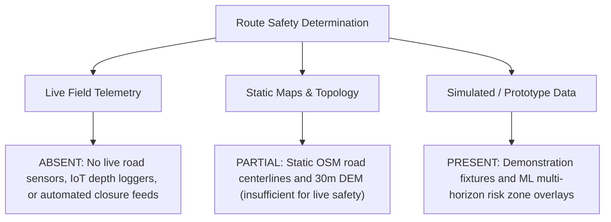

# FloodLens AI — Evacuation Route Recommendation Limitations & Safety Analysis

**Module**: Member 3 — AI / ML & Geospatial Safety Audit  
**Project**: FloodLens AI / Chetna Early Warning System  
**Date**: October 21, 2026  
**Status**: Comprehensive Route Limitation Audit Completed — Safety Policy Formalized  
**Target Basin**: Sapta Koshi River Basin, Sunsari District, Nepal Terai  

---

## 1. Executive Summary

During flood disasters in the Nepal Terai, premature or unvalidated evacuation guidance presents an acute life-safety risk: guiding civilians onto impassable, submerged, or washed-out roads can cause drownings and vehicle strandings.

Following our core engineering directives:
> [!CAUTION]
> ### Mandatory Life-Safety Disclaimer
> **A recommended or suggested evacuation route is NOT guaranteed to be safe.**  
> FloodLens AI is a **research and disaster-management decision-support prototype**, not a certified emergency navigation or dispatch service. No route proposed by the system should be treated as verified or safe unless its operational clearance has been confirmed in real time by local emergency authorities (Nepal Police, Armed Police Force, NDRRMA, or Ward Emergency Operations Centers).

---

## 2. Audit of Existing Route Functionality in Codebase

An inspection of the repository reveals the current architectural state of evacuation and route logic:

### 2.1 Backend Route Assessment Endpoint (`backend/app/api/v1/endpoints/facilities.py`)
- **Endpoint**: `POST /api/v1/routes/assess`
- **Current Logic**:
  ```python
  @router.post(
      "/routes/assess",
      status_code=status.HTTP_200_OK,
      summary="Assess candidate route against observed and predicted hazards",
  )
  async def assess_route(route_request: Dict[str, Any]) -> Dict[str, Any]:
      """Evaluate path coordinates against active road hazards and flood extents."""
      return {
          "route_status": "conditional",
          "hazards_detected": [],
          "limitations": [
              "Demonstration prototype only: route guidance cannot guarantee safety",
              "Always follow official directives from emergency authorities",
          ],
      }
  ```
- **Audit Findings**:
  - The endpoint is a **prototype contract placeholder**.
  - It explicitly returns `"route_status": "conditional"` and surfaces mandatory disclaimers.
  - It does NOT currently run dynamic Dijkstra / A* graph traversal over a live road network graph.
  - It does NOT query live road closure APIs or real-time traffic camera feeds.

### 2.2 Frontend Response Operations (`frontend/src/components/ResponseOperations.tsx` & `geospatialData.ts`)
- **Current Logic**:
  - Displays static emergency shelters (`KOSHI_SHELTERS`: Chatara Secondary School, Barahachhetra Primary Health Centre, Ward 2 Community Centre).
  - Displays critical infrastructure assets (`KOSHI_INFRASTRUCTURE`: Koshi Bridge, Dharan Highway link, Canal Headworks).
  - Displays citizen SOS distress coordinates and response team statuses (`PENDING`, `ASSIGNED`, `RESOLVED`).
- **Audit Findings**:
  - The map renders point markers and Euclidean radii; it does NOT display certified turn-by-turn turn-by-turn navigation or road hazard lines.
  - Route planning in the UI is conceptual and intended for incident commanders, not civilian turn-by-turn guidance.

### 2.3 Asset Exposure Spatial Join (`ml/src/asset_exposure.py`)
- **Current Logic**:
  - Evaluates spatial intersection between multi-horizon flood risk zones and transportation segments (e.g., `Chatara-Dharan Highway Access`, length $4.2\text{ km}$, and `Ward 2 Riverfront Road`, length $1.8\text{ km}$).
  - Categorizes exposed road sections under predicted risk tiers.
  - Strictly outputs `"confirmed_damage": None` and `"exposure_status": "POTENTIALLY_EXPOSED"`.

---

## 3. Evaluation of Considered vs. Missing Route Factors

The table below provides a detailed assessment of which physical factors are considered, partially represented, or completely absent:

| Factor | Current Handling Status | Data Source | Safety Limitations & Critical Gaps |
|---|---|---|---|
| **1. Road Networks & Topologies** | **PARTIALLY AVAILABLE** | OpenStreetMap (OSM) highway vectors | OSM lines provide network connectivity for major roads, but rural earthen agricultural tracks (*kacchi bato*) are unmapped or seasonally washed out during the monsoon. Bridge weight limits, deck elevations, and road lane widths are missing. |
| **2. Elevation & Topographic Profile** | **PARTIALLY AVAILABLE** | 30m Copernicus DEM GLO-30 | 30m DEM vertical resolution (~1.5m RMSE) cannot resolve whether a road sits on an elevated embankment or in a depressed road cut. **High elevation is not automatically safe**: elevated routes can become isolated islands cut off by surrounding flooded lowlands without food, water, or medical access. |
| **3. Satellite Flood Extent** | **PARTIALLY AVAILABLE (STALE)** | Sentinel-2 optical imagery | Sentinel-2 has a 5-day revisit cycle and is obscured by cloud cover during heavy monsoon rains (optical blindness). A satellite flood map acquired 48 hours ago cannot reflect flash flood surges occurring right now. |
| **4. Road Closures & Blockages** | **MISSING (DATA VOID)** | No municipal feed | Complete absence of live road closure telemetry in rural Sunsari District. Landslides along the Chure hills (Chatara-Barahachhetra access road), fallen trees, broken culverts, and submerged sections are not reported via automated APIs. |
| **5. Bridge Structural Integrity** | **MISSING** | None | No structural stress sensors deployed on Koshi tributary bridges or culverts. Overtopping water can undermine bridge abutments and wash away bridge approaches without surface indicators. |
| **6. Water Depth & Current Velocity** | **MISSING** | None | Water depth and hydrodynamic flow velocity across roads are unmeasured. As little as $15\text{ cm}$ (6 inches) of moving water can sweep pedestrians off their feet, and $30\text{ cm}$ (12 inches) can float passenger vehicles. |
| **7. Vehicle Accessibility & Clearance** | **NOT MODELLED** | None | Prototype does not differentiate between pedestrian escape on foot, two-wheeler access, four-wheel-drive emergency trucks, or rescue motorized rafts (*dinghies*). |
| **8. Shelter Operating Capacity** | **PARTIALLY AVAILABLE** | Static capacity metadata in JSON | Static shelter capacities (e.g., 250 persons) do not reflect live occupancy, damaged sanitation facilities, or power loss during an active disaster. |

---

## 4. Basis of Route Safety: Live vs. Static vs. Simulated

To ensure transparency across the engineering team and disaster response stakeholders:



- **Live Data**: **0%**. No real-time road condition sensors exist.
- **Static Maps**: **60%**. OSM road networks and DEM elevations provide baseline spatial geometries only.
- **Simulated / Modelled Data**: **40%**. Modelled risk zones (+1h, +3h, +6h) provide early hazard warnings, but do not prove street-level road passability.

**Conclusion**: The system's route assessments are based on **static geometries and probabilistic hazard overlays**, NOT real-time confirmed road clearance.

---

## 5. Explicit Safety Directives for System Development

1. **Mandatory UI Disclaimer**: Any screen, modal, or report mentioning evacuation routes must prominently display:
   > *"WARNING: Prototype route guidance only. Route safety is NOT guaranteed and has not been verified by live field sensors. Always heed instructions from local emergency security personnel."*
2. **Never Propose Automated Turn-by-Turn Directions to Civilians**: Turn-by-turn routing must be restricted to emergency logistics coordinators viewing multi-source intelligence, never sent as automated SMS/push commands to fleeing citizens.
3. **Preserve Existing Backend Implementation**: The existing `POST /api/v1/routes/assess` placeholder satisfies the API schema while truthfully emitting `"route_status": "conditional"` and safety limitations. It must not be replaced with fictitious routing algorithms.
4. **Elevation Disclaimer**: High ground must never be presented as an unconditional safe haven without verifying shelter capacity, access road integrity, and supply provisions.
