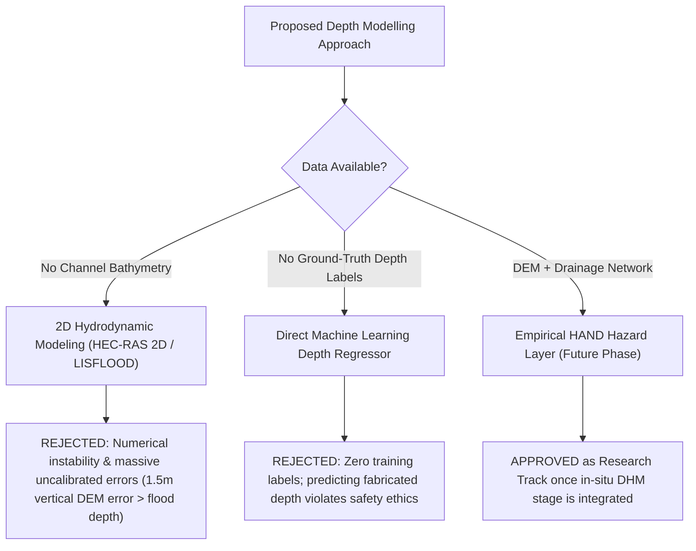

# FloodLens AI — Flood-Depth Modelling Data Readiness Assessment

**Module**: Member 3 — AI / ML & Hydrological Risk Baseline  
**Project**: FloodLens AI (Sapta Koshi Basin, Nepal Terai)  
**Date**: October 19, 2026  
**Status**: Comprehensive Assessment Completed — Operational Depth Modelling Deferred Due to Data Gaps  

---

## 1. Executive Summary

A core objective of FloodLens AI Day 3 is to evaluate whether existing project data, telemetry feeds, and terrain models can support the scientific estimation of **floodwater depth** (e.g., in meters). 

Following our strict engineering ethics:
> [!IMPORTANT]
> **Key Finding: Data is INSUFFICIENT for Operational Flood-Depth Estimation.**  
> While rainfall and satellite flood extent are available, **river channel cross-section bathymetry**, **sub-meter topography (LiDAR)**, **drainage culvert dimensions**, and **ground-truth water depth measurements** are entirely absent. Training an ML depth regressor or executing 2D hydrodynamic simulations under these conditions would violate engineering safety principles and produce fabricated, misleading flood depths.

The platform retains its **discrete 4-tier risk classification (+1h, +3h, +6h)** as the verified baseline, while establishing a clear data-readiness roadmap for future hydraulic depth integration.

---

## 2. Input-by-Input Evaluation Matrix

| Input Factor | Readiness Status | Spatial Resolution | Temporal Frequency | Units | Source / Format | Data Quality & Feasibility Assessment |
|---|---|---|---|---|---|---|
| **1. Rainfall Intensity & Accumulation** | **AVAILABLE** | ~25 km grid cell | Hourly | mm/h, mm (3h, 6h, 24h) | Open-Meteo ERA5 Reanalysis CSV | **Feasible for runoff volume estimation.** ERA5 25km grid cell smooths localized mountain cloudbursts; in-situ DHM rain gauge telemetry API remains an external blocker. |
| **2. Digital Elevation Model (DEM)** | **PARTIALLY AVAILABLE** | 30 meters horizontal | Static baseline | Meters above sea level | Copernicus DEM GLO-30 / SRTM 30m GeoTIFF | **Too coarse for depth calculation.** Vertical RMSE (~1.5 m) exceeds typical street flood depths. Fails to resolve road embankments, levees, and roadside ditches in flat Terai plain. |
| **3. Terrain Slope & Low-Lying Areas** | **PARTIALLY AVAILABLE** | 30 meters horizontal | Static baseline | Degrees / % slope, TWI index | Derivable from 30m DEM | **Useful for macro hazard indexing only.** Terai plain gradient is < 0.1%, causing standard D8 flow direction algorithms to fail without manual stream burning. |
| **4. Drainage Capacity & Blockages** | **MISSING** | Unmapped | None | m³/s capacity, % blockage | None in Nepal municipal repositories | **Complete data void.** No culvert invert levels, stormwater ditch dimensions, or trash-rack maintenance telemetry exist for Barahachhetra rural wards. |
| **5. River Bathymetry & Water Level** | **REQUIRES VALIDATION** | Point benchmark (Chatara) | Hourly benchmark specs | Meters stage ($W_t$), m³/s discharge ($Q_t$) | DHM Chatara 695 thresholds, GloFAS discharge | **Channel bathymetry absent.** Without river bottom cross-sections below the water line, river stage cannot be converted into channel overflow depth or volume. |
| **6. Ground-Truth Flood Depth** | **PARTIALLY AVAILABLE** (Extent only) | 10 meters (Sentinel-2) | 5-day revisit (optical) | Binary (0/1), area in km² | Sentinel-2 NDWI/MNDWI flood extent vectors | **CRITICAL GAP: Extent $\ne$ Depth.** Satellites detect surface water presence, NOT water depth. High-water marks (HWM) and ground-surveyed depth logs are completely absent. |
| **7. Soil Infiltration & Roughness** | **PARTIALLY AVAILABLE** | 10m landcover, 1km soil | Static annual map | Manning's $n$ (0.025–0.150), HSG | FAO HWSD soil & ESA WorldCover 10m | **Uncalibrated.** Infiltration parameters introduce $\pm 40\%$ runoff volume uncertainty without in-situ soil tests. |
| **8. IoT Water-Level Sensors** | **MISSING** | No nodes deployed | None | Centimeters / meters depth | None | **Hardware network unbuilt.** No ultrasonic or radar staff gauges deployed along Chatara tributaries. |

---

## 3. Recommended vs. Unsupported Modelling Approaches

### Recommended Approach: Empirical Height Above Nearest Drainage (HAND)
Once in-situ river stage telemetry from DHM Station 695 is restored:
- Compute **HAND (Height Above Nearest Drainage)** from hydro-conditioned elevation grids.
- Couple HAND with DHM river stage-discharge rating curves to calculate relative inundation threshold head.
- **Advantage**: Avoids fictitious hydrodynamic precision while remaining physically grounded in gravitational drainage topology.

### Strictly Unsupported Approaches (Rejected as Misleading)

1. **Direct Machine Learning Regression of Flood Depth (meters)**:
   - *Why Rejected*: There are zero ground-truth water depth training labels in the historical dataset. Training an ML regressor on synthetic or uncalibrated depth labels would fabricate false precision.
2. **2D Hydrodynamic Modelling (Shallow-Water Equations)**:
   - *Why Rejected*: 2D hydrodynamic solvers require sub-meter LiDAR topography, bridge piers, culvert geometry, and channel bathymetry. Applying a 30m satellite DEM directly causes false artificial dams and depth errors exceeding 100%.

---

## 4. Next Steps Action Plan

1. **Maintain Clear Product Distinction**:
   - Keep **Predicted Flood Risk** (low / moderate / high / critical), **Observed Flood Extent** (polygons), and **Flood Depth** as separate, unconfused concepts across backend, frontend, and Android clients.
2. **Bathymetry Acquisition**:
   - Request Acoustic Doppler Current Profiler (ADCP) river cross-section surveys from the Nepal Department of Water Resources and Irrigation (DWRI).
3. **High-Resolution Topography**:
   - Ingest 1-meter airborne LiDAR tiles or drone photogrammetry for high-risk settlements in Barahachhetra Ward 2.
4. **Deploy Low-Cost Ultrasonic IoT Staff Gauges**:
   - Place 2–3 solar-powered IoT distance sensors on Chatara bridge and tributary culverts to establish real ground-truth depth observations for future model calibration.
