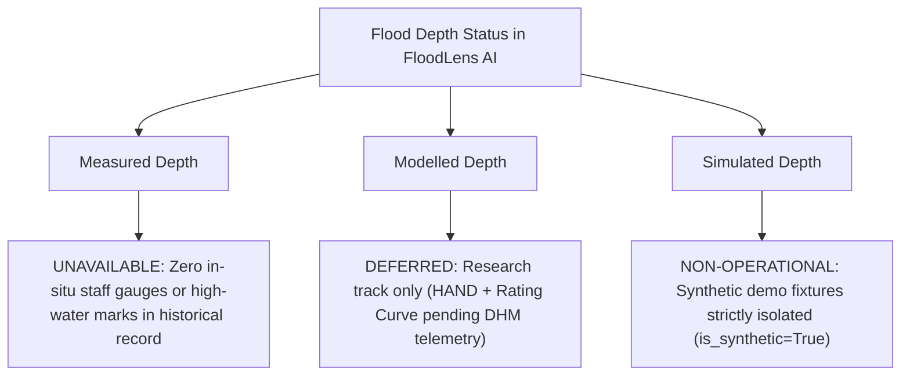

# FloodLens AI — Inundation and Flood-Depth Assumptions & Limitations

**Module**: Member 3 — AI / ML & Geospatial Hydrological Engineering  
**Project**: FloodLens AI / Chetna Early Warning System  
**Date**: October 21, 2026  
**Status**: Comprehensive Assessment Documented — Operational Depth Modelling Deferred Due to Data Gaps  
**Target Basin**: Sapta Koshi River Basin, Chatara Gorge & Barahachhetra Ward 2, Sunsari District, Nepal Terai  

---

## 1. Executive Summary and Foundational Distinction

A core engineering and scientific responsibility on Day 4 is to establish an uncompromised, transparent accounting of how flood risk, water levels, and inundation are computed across FloodLens AI.

> [!IMPORTANT]
> ### Critical Distinction: Flood-Risk Classification vs. Flood-Depth / Inundation Prediction
> - **Flood-Risk Classification (Implemented & Validated)**:
>   - Predicts an **ordinal hazard severity level** (`low`, `moderate`, `high`, `critical`) across +1h, +3h, and +6h forecast lead times.
>   - Indicates the **probabilistic likelihood of dangerous hydrological conditions** (monsoon cloudburst runoff, river stage rise, upstream discharge surge) exceeding physical alert thresholds established by Nepal disaster authorities (NDRRMA & DHM).
> - **Flood-Depth Prediction (Unobserved Data Limitation — Deferred)**:
>   - Predicts a **continuous physical water depth** (e.g., $0.45\text{ m}$ of standing water above road grade) at a specific geographic coordinate.
>   - Requires sub-meter Digital Terrain Models (LiDAR), in-channel river cross-section bathymetry, stormwater pipe/culvert invert dimensions, and calibrated hydraulic roughness coefficients.
>   - **Current Operational Status**: **UNAVAILABLE**. No measured ground-truth depth observations exist in the historical record. Direct machine-learning regression of floodwater depth is strictly rejected to prevent fabricating ungrounded depth numbers that could mislead evacuation teams and endanger lives.

---

## 2. Inundation & Depth Input Factors Evaluation

The table below outlines how each candidate hydrological and geospatial input is currently used, partially available, or absent:

| Input Factor | Operational Status | Current Resolution / Source | How It Is Used in FloodLens AI | Limitations, Uncertainties & Failure Modes |
|---|---|---|---|---|
| **1. Rainfall Intensity & Accumulation** | **AVAILABLE** | Hourly, ~25 km grid cell (Open-Meteo ECMWF ERA5) | Multi-scale rolling features: $R_{1\text{h}}, R_{3\text{h}}, R_{6\text{h}}, R_{24\text{h}}$. Primary driver in Random Forest and GBDT risk classifiers. Benchmarked against NDRRMA alert thresholds ($25\text{ mm}$, $100\text{ mm}$, $150\text{ mm}/24\text{h}$). | Coarse 25 km grid smooths localized mountain cloudbursts; sub-hourly convective storm spikes (<15 min) are obscured. In-situ DHM tipping-bucket rain gauge API is an external dependency blocker. |
| **2. Elevation & Topography** | **PARTIALLY AVAILABLE** | 30-meter horizontal, static (Copernicus DEM GLO-30 / SRTM) | Used for macro slope, catchment boundaries, and ward-level topographic context. | **Vertical error (~1.5 m RMSE) exceeds typical overland flood depths (0.2–1.0 m).** Fails to resolve critical micro-topography: highway embankments, agricultural bunds, irrigation canal walls, and roadside ditches in the flat Terai plain. |
| **3. Terrain Slope & Depressions** | **PARTIALLY AVAILABLE** | 30-meter, static | Macro slope index. Terai plain gradient is < 0.1% ($<1\text{ m}$ drop per km). | Standard D8 flow direction algorithms fail on flat topography without high-resolution hydro-enforcement and stream burning. Creates false depressions and artificial sinks in hydrodynamic solvers. |
| **4. Land Use & Soil Infiltration** | **PARTIALLY AVAILABLE** | 10m ESA WorldCover 2021, 1 km FAO HWSD soil | Used in asset exposure categorization (farmland, settlements, transport links) and conceptual catchment saturation index (`saturated`, `wet`, `normal`). | Infiltration rates (SCS Curve Number / Green-Ampt) are uncalibrated with in-situ double-ring infiltrometer tests. Monsoon soil saturation shifts dynamically with antecedent rain, introducing $\pm 35\%$ runoff volume uncertainty. |
| **5. Drainage Network & Blockages** | **MISSING (DATA VOID)** | Unmapped in Nepal municipal repositories | **Not used.** Cannot be incorporated into statistical models. | Complete data void. No culvert invert elevations, roadside drain cross-sections, or trash-rack maintenance telemetry exist for Barahachhetra rural wards. Localized stormwater surcharge cannot be modelled. |
| **6. Historical Flood Extents** | **PARTIALLY AVAILABLE** | 10-meter optical Sentinel-2 (NDWI / MNDWI) | Used as spatial validation overlay for historical flood footprints (2017 & 2024 monsoons). | **Extent $\ne$ Depth.** Satellites detect surface water presence, NOT water column depth. Optical sensors are blind during heavy monsoon cloud cover (80–95% cloud obscuration during peak rainfall). |
| **7. River Bathymetry & Stage** | **REQUIRES VALIDATION** | Point station specs (DHM Chatara 695: Lat 26.87°N, Lon 87.16°E); GloFAS daily discharge proxy | GloFAS daily discharge ($Q$) used in feature engineering and risk classification. DHM Station 695 warning ($6.0\text{ m}$) and danger ($7.0\text{ m}$) levels used in explainability benchmarks. | **Channel bathymetry is absent.** Without cross-sectional underwater riverbed profiles, river stage cannot be converted into overbank discharge volume. Nepal DHM public REST API is unavailable, requiring GloFAS reanalysis proxies. |
| **8. Water-Level Sensor Readings** | **MISSING (HARDWARE)** | No telemetry nodes deployed | **Not used.** Simulated values in synthetic datasets are strictly flagged with `is_synthetic: True`. | Zero IoT ultrasonic or radar staff gauges deployed along Chatara tributaries. Real-time water-level feedback loops are unavailable. |

---

## 3. Flood Depth Categorization Status

To eliminate ambiguity across API responses, frontend dashboards, and technical documentation:

1. **Measured Depth**: **`UNAVAILABLE`**  
   - There are zero ground-surveyed high-water marks (HWM) or continuous water depth loggers in Barahachhetra Ward 2.
2. **Modelled Depth**: **`DEFERRED / EXPERIMENTAL RESEARCH TRACK ONLY`**  
   - Direct 2D hydrodynamic modeling (e.g., HEC-RAS 2D or LISFLOOD-FP) on 30m DEM is scientifically rejected due to vertical errors exceeding water depths.
   - The scientifically defensible path forward is **Height Above Nearest Drainage (HAND)** coupled with empirical DHM stage-discharge rating curves once in-situ telemetry is restored.
3. **Simulated Depth**: **`PROTOTYPE SYNTHETIC DEMO ONLY`**  
   - Parametric scenarios used in Day 1 synthetic fixtures (`is_synthetic: True`) serve strictly for UI rendering and component integration tests. They must never be represented as actual flood observations.

---

## 4. Key Assumptions in Current Risk Classification Pipeline

1. **Stationary Hydro-Meteorological Response**: The Random Forest and GBDT candidate models assume that the relationship between upstream discharge ($Q$), rolling rainfall ($R_{24\text{h}}$), and flood hazard severity remains stationary across monsoon seasons.
2. **Reanalysis as Proxy Ground Truth**: The labeling strategy derives ground-truth risk tiers from ERA5 reanalysis and GloFAS percentiles ($p90, p95$). While grounded in NDRRMA/NRRC guidelines, reanalysis models represent smoothed atmospheric simulations rather than physical gauge records.
3. **Uniform Catchment Response**: Barahachhetra Ward 2 is treated as a cohesive hydrologic response unit. Spatial variability within the ward (e.g., differences between alluvial river islands and elevated terrace settlements) is simplified to ward-level spatial containment.
4. **Independent Lead-Time Forecasting**: Each horizon (+1h, +3h, +6h) is trained as a dedicated estimator. Dynamic feedback between consecutive hourly predictions is not enforced.

---

## 5. Conditions Under Which Predictions May Be Unreliable

The AI/ML risk classification pipeline may exhibit degraded reliability or false indications under the following operational scenarios:

1. **Sudden Cloudbursts (<1 Hour Onset)**: Convective thunderstorm cells producing $>50\text{ mm}$ in 30 minutes over sub-grid mountain catchments will not register in 25 km reanalysis until the subsequent hourly model cycle.
2. **Upstream Glacial Lake Outburst Floods (GLOF)**: Glacial lake outbursts in the Tibetan / upper Koshi catchment (e.g., Dudh Koshi, Sun Koshi) generate massive surge waves without corresponding local precipitation. In the absence of real-time upstream telemetry, rainfall-based models will miss early flood arrival.
3. **Levee or Embankment Breaches**: Sudden structural failure of the Koshi river flood protection embankments (such as the catastrophic August 2008 Kusaha breach) alters flow paths entirely, invalidating topographic assumptions.
4. **Local Stormwater Drain Clogging**: Intense urban waterlogging caused by solid waste blockages in roadside culverts occurs independently of mainstem river discharge.
5. **Sensor / API Outages**: If input meteorological or discharge feeds fail, the predictor emits `data_quality: "UNAVAILABLE"` and `risk_level: "unknown"`, refusing to fabricate low-risk classifications.

---

## 6. Engineering & Safety Declarations

- **No Fabricated Precision**: FloodLens AI will never output uncalibrated continuous water depths (e.g., *"0.62 meters"*) without verifiable ground-truth sensor telemetry and sub-meter LiDAR elevation boundaries.
- **Human-in-the-Loop Safeguard**: Machine learning outputs serve strictly as early-warning decision support for authorized emergency managers. They must never trigger automated public panic sirens or mandatory evacuation orders without human validation.
